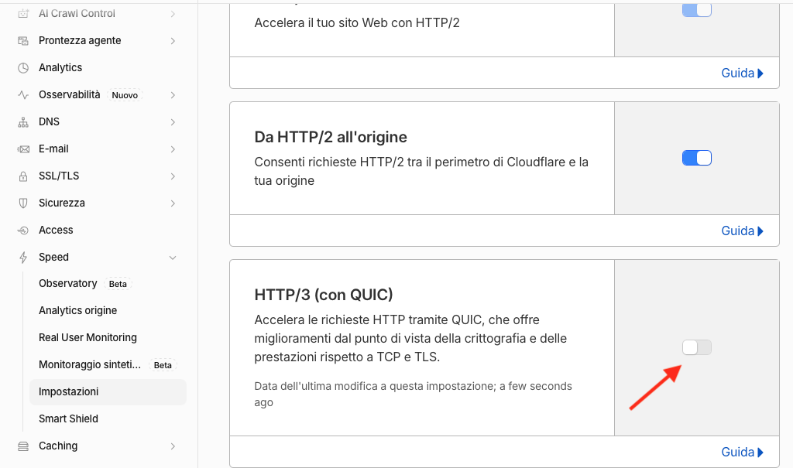

# Builds-DocsTool-COM
Pacchetti di installazione e aggiornamento di DocsTool-COM (firmati)

## Installazione

- **macOS**: `DocsTool-COM-<versione>.pkg` dalle [release](https://github.com/robertocalvi/Builds-DocsTool-COM/releases/latest). Al primo doppio clic macOS lo blocca: aprirlo con **clic destro > Apri**. L'installatore chiede la cartella dei dati e la porta (proposta 17800), installa il servizio e apre il browser. Primo accesso: utente `admin`, password `admin` (da cambiare subito).
- **Windows**: `DocsTool-COM-<versione>-setup.exe` dalle stesse release.
- Gli aggiornamenti si installano dall'app: **Impostazioni → Aggiornamento**.

## Pubblicazione su Internet con Cloudflare: spegnere HTTP/3

Se DocsTool-COM è raggiungibile tramite Cloudflare (tunnel o proxy), nel dominio va spento **HTTP/3**:
dash.cloudflare.com → dominio → **Speed → Impostazioni → Protocollo** → **HTTP/3 (con QUIC)** su spento.
HTTP/2 e "Da HTTP/2 all'origine" restano accesi.

Con HTTP/3 acceso Safari (Mac e iPhone) carica gli allegati molto lentamente: un file di 2,4 MB richiede circa 139 secondi invece di 2. Spegnerlo non ha svantaggi pratici: il sito resta su HTTP/2.
